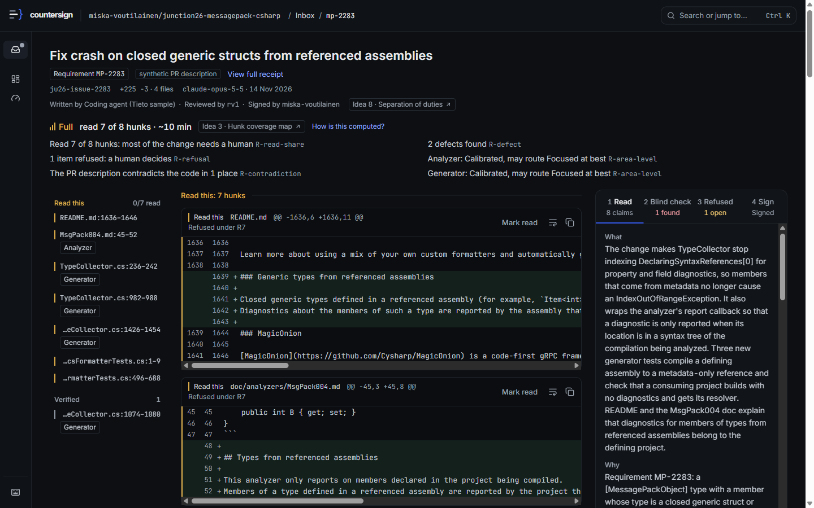

# Countersign

**Eight ideas for reviewing agent-written code, each shown working on Tieto's real repository.**

AI reviews. A named human countersigns, on evidence they can check.

Coding agents now produce more code than people do (agent tokens passed human tokens in February 2026, [challenge](docs/challenge.md)), and line-by-line review doesn't scale. Countersign is a set of ideas for how AI review can keep pace while a named person stays accountable. Each idea stands on its own, so a product team can adopt one without the others. The app is the reference implementation: it proves the ideas on agent-written changes to Tieto's sample repository.

## The ideas

1. **[Planted-bug calibration and a trust ladder per area](docs/ideas/trust-ladder.md).** We test the AI reviewer on bugs planted by someone who never sees its prompts. Its catch rate in each area decides how much a human reads, and an escaped bug drops that area a level.
2. **[Blind-first review](docs/ideas/blind-first.md).** The reviewer writes down what the requirement should produce before it reads the code or the author's description. We measure how much reading the description first costs.
3. **[The hunk coverage map](docs/ideas/coverage-map.md).** "Read 6 of 8 hunks, and here is what covers the other 1" (the recorded review of `mp-2283`), from rules a person can read, with no AI in the routing.
4. **[A mechanical quote check](docs/ideas/quote-check.md).** Every AI claim cites the code. A citation that doesn't match the code is never shown, and each one caught counts as a hallucination.
5. **[A written refusal policy](docs/ideas/refusal-policy.md).** A versioned list of what the AI never decides, each item naming who decides instead.
6. **[Evidence levels instead of confidence scores](docs/ideas/evidence-levels.md).** A claim is Verified, Supported, Unverified or Refused by what backs it; the model's own confidence is never shown.
7. **[The signed receipt in git](docs/ideas/signed-receipt.md).** The owner signs what was checked, what wasn't and the risk they accept, tied to the exact diff, so the receipt can gate the merge.
8. **[The author never checks its own work](docs/ideas/separation-of-duties.md).** An agent's own test makes a claim Supported at most, the AI drafts the receipt but only a named person signs it, and whoever plants the bugs never sees the prompts.

Each idea has its own page in [`docs/ideas/`](docs/ideas/): the problem, how it works, what we measured, how to adopt it, its limits and where it lives in the code.

What the AI does in the product, what stays with rules and people, and why the reviewer doesn't learn on its own: [How Countersign uses AI](docs/how-countersign-uses-ai.md).

## See them working

**Live:** https://countersign-junction.com. Start at the review of `mp-2283`; each idea is labelled where it appears and links to its page.



| Screen                               | What it answers                                                                                                                                           |
| ------------------------------------ | --------------------------------------------------------------------------------------------------------------------------------------------------------- |
| Inbox (`/`)                          | Which changes need a person, how much of each, and whose receipt is signed or stale                                                                       |
| Review (`/changes/mp-2283`)          | What the change does, claim by claim with evidence; what to read and why; what the AI refused to decide; the receipt                                      |
| Report card (`/reviewer`)            | How often the reviewer caught planted bugs per area, and how much it may be trusted there. "Record escape" lowers an area and re-routes every change live |
| Receipt (`/changes/mp-2283/receipt`) | The signed receipt: what was checked, what wasn't, the risk accepted, and the `verify` output                                                             |
| Dashboard (`/dashboard`)             | Signed changes, open decisions by who decides them, and why changes were escalated                                                                        |

Built at Junction 2026 for Tieto's challenge, **Earned Trust in AI Code** ([challenge text](docs/challenge.md)). What we build: [docs/spec.md](docs/spec.md). Why: [docs/decisions.md](docs/decisions.md). How the ideas came about and fit together: [From the challenge to the product](docs/ideas/from-challenge-to-product.md).

## Tieto's repository and the four changes

Tieto gave a copy of MessagePack-CSharp, a C# serializer with a Roslyn source generator and analyzer, with four agent-written changes on one base commit. We review all four; `mp-2283` is the demo.

| Change    | Issue                                                                              | Size                                     |
| --------- | ---------------------------------------------------------------------------------- | ---------------------------------------- |
| `mp-2283` | Generator and analyzer crash on a closed generic struct from a referenced assembly | 4 files, +225 −3                         |
| `mp-2234` | The analyzer does not work if `SuppressSourceGeneration = true`                    | 4 files, +262 −4                         |
| `mp-2129` | Allow generating a formatter for a type in a referenced assembly                   | 28 files, +1034 −9                       |
| `mp-2297` | Add `ExcludeFromCodeCoverage` to generated code                                    | 237 files (223 test snapshots), +1383 −9 |

## What's real and what's synthetic

- **Real:** Tieto's code and the four changes; every review on the site, recorded from `claude-opus-5-5` and replayed (the site makes no model calls); the quote check, routing and test results computed from them; the signed receipt for `mp-2283`, a git note in our fork that `pnpm countersign verify` checks.
- **Synthetic or derived, and labelled so:** the author PR descriptions (the commits carry one-line messages); the 10 planted-bug variants and the planted contradictions the reviewer is measured on, written by an agent that never saw the reviewer's prompts; the requirement records, derived from the upstream issues until Tieto's arrive.
- **Simulated:** escapes. "Record escape" on the report card is stored in your browser only.

Measured results, including what didn't work (security caught 1 of 3 planted bugs, in 3 of 3 runs for one and 0 of 3 for the other two; blind-first showed no advantage on our sample), are in [docs/lessons.md](docs/lessons.md).

## Stack

Next.js 16 (static, no server state) with React 19, TypeScript, Tailwind CSS and shadcn/ui, deployed on Vercel. The review pipeline and the receipt CLI are TypeScript on Node 24; the model is Anthropic `claude-opus-5-5` behind one client with record and replay; A5 runs .NET 8 tests in Docker; receipts are signed with `ssh-keygen -Y` and stored as git notes. Architecture: [docs/architecture.md](docs/architecture.md).

<!-- demo-prep keeps the next section word for word: it is the team's declaration of what existed before the event. -->

## Prepared before the event

Junction 2026 started on Fri 13.11.2026 at 19:30 EET. The rules let teams bring Markdown files but no code. This is everything that existed before 19:30, and when work started. Times are EET, from GitHub and `git log`; check them with `git log --reverse` and `gh repo view --json createdAt`.

| Time (Fri 13.11) | What happened                                                                                                                                                                                                                                                                            |
| ---------------- | ---------------------------------------------------------------------------------------------------------------------------------------------------------------------------------------------------------------------------------------------------------------------------------------- |
| 19:12            | Empty repository created on GitHub                                                                                                                                                                                                                                                       |
| 19:13            | Issue #1 (the agent sync log) opened with a one-line description; first comment at 20:49                                                                                                                                                                                                 |
| 19:30            | Event starts                                                                                                                                                                                                                                                                             |
| 19:40            | First commit `bac8ef7`, `chore: add agent environment`: 38 Markdown files written before the event (rules, skills, subagent definitions, templates, setup guide) and two plain-text config files, `.gitignore` (9 ignore patterns) and `.gitattributes` (one line, `* text=auto eol=lf`) |
| 22:03            | First code: the skeleton, PR #26                                                                                                                                                                                                                                                         |

The Markdown is project-agnostic. It never names Countersign, Tieto or the challenge, and `docs/spec.md` in that commit is an empty template. We picked the challenge, the idea, the name and the spec at the event. Every line of code, including the hooks, settings and CI that the Markdown describes, was written during the event by the team and its agents. Nothing from other projects is in this repository; tools such as Lightfoot and Graphify run on our laptops and are not committed.

## How to run

```bash
git clone https://github.com/miska-voutilainen/junction-2026.git
cd junction-2026
pnpm install --frozen-lockfile
cp .env.example .env   # the app runs without values; see development.md
pnpm dev               # http://localhost:3000
```

Needs Node 24 and pnpm. The site reads the committed files under `data/`. The receipt CLI is built, and so are review steps A1 to A5 with the quote check; the fork clone (`pnpm seed`), the .NET SDK, every command and the env vars are in [docs/development.md](docs/development.md).

## How we built it with AI

Three people, each running Claude Code on their own lane of the repository (engine, app, evidence), working from one spec. A main session on Claude Opus planned, reviewed and integrated; Sonnet subagents wrote most of the code from written briefs; a `code-reviewer` subagent reviewed every pull request that changed behaviour before it merged, at a depth set by its risk (small docs and copy changes skip it). Every PR has an **AI use** section saying which models and agents did what. The planted bugs were written by an isolated agent that never saw the reviewer's prompts or recorded output, so the reviewer's catch rate isn't graded by its own author.

People decided the idea, the spec, the lanes, what to cut and what each measured result meant; those decisions are in [docs/decisions.md](docs/decisions.md). The agent environment we brought (rules, skills, subagents, hooks) and how it was made: [docs/setup.md, section 8](docs/setup.md#8-the-agent-environment).

## Team

| Name  | GitHub              | Lane           |
| ----- | ------------------- | -------------- |
| Miska | `miska-voutilainen` | engine and app |
| Elias | `eliasnorta`        | app (UI)       |
| Veijo | `Kasanen`           | evidence       |
