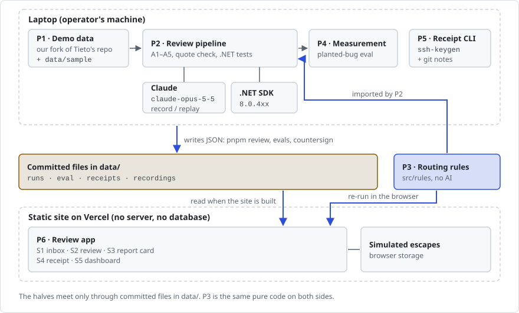

# Architecture

Countersign has two halves that never meet at runtime. A **laptop half** (the review pipeline, the receipt CLI, git, .NET and the model) writes JSON files into `data/`. A **static site** on Vercel reads those committed files and shows them. There is no server and no database. What is built and what is only specified is marked in the tables below; the spec is [docs/spec.md](spec.md), section 1 ("Product in parts") and section 4 (data).

<picture>
  <source media="(prefers-color-scheme: dark)" srcset="img/architecture-dark.svg">
  
</picture>

P7 (Tieto deliverables: idea pages, concept card, decision log, video, deck) is documentation and a recording, so it has no box. The idea pages are in [docs/ideas/](ideas/README.md).

**Boundaries.** P2 never decides a tier itself; it calls P3. P3 never calls a model, and it is plain TypeScript that runs both in the pipeline and in the browser. The site (P6) never runs the pipeline and never signs anything: it reads recorded files and re-runs P3 client-side. P5 is the only part that writes git notes. Everything that needs git, .NET or a model runs on a laptop.

## Components

| Component                 | What it does                                                                                                                                                                | Status                                                                                                                                                                                       | Code                                                            |
| ------------------------- | --------------------------------------------------------------------------------------------------------------------------------------------------------------------------- | -------------------------------------------------------------------------------------------------------------------------------------------------------------------------------------------- | --------------------------------------------------------------- |
| P1 · Demo data            | Our fork of Tieto's MessagePack-CSharp, a branch per change and per planted bug, requirements, author descriptions, answer keys. The evidence lane writes the plants blind. | Built: four Tieto changes, ten planted-bug inputs and four contradiction-plant inputs, their requirements, answer keys, `allowed_signers`; `pnpm seed` clones the fork                       | `scripts/seed.ts`, `data/sample/`                               |
| P2 · Review pipeline      | Reviews one change and writes `data/runs/<changeId>/review.json`. Steps A1 to A5 and the quote check, below.                                                                | A1 to A5 and the quote check built (`pnpm review run <changeId>`)                                                                                                                            | `src/pipeline/`, `src/prompts/`, `src/ai/`, `src/lib/git/`      |
| P3 · Routing rules        | `route()` turns a review and the per-area trust levels into a tier, one-line reasons and a coverage state per hunk. The trust ladder gives the levels.                      | Built, with unit tests                                                                                                                                                                       | `src/rules/route.ts`, `src/rules/ladder.ts`, `src/policy/`      |
| P4 · Reviewer measurement | Scores recorded planted-bug runs against the answer keys and writes the report card.                                                                                        | Built, with unit tests: `pnpm evals` records the runs, scores them, writes the report card and routes the Tieto reviews again                                                                | `src/pipeline/eval/`                                            |
| P5 · Receipt              | Drafts a receipt from the review, the owner signs it with their SSH key into a git note, `verify` checks signature and diff identity.                                       | Built, with unit tests (signing in a temp repo with a throwaway key); the demo receipt is not signed yet                                                                                     | `src/receipt/`, `src/lib/git/diffIdentity.ts`                   |
| P6 · Review app           | Static Next.js site: inbox, review page, report card, receipt, dashboard. Loaders prefer recorded files and fall back to fixtures, with a "Showing mock data" banner.       | Built. Each file is read from `data/` where it is recorded, else from `data/fixtures/`, and a receipt only from the same source as its review; any page that used a fixture shows the banner | `src/app/`, `src/features/`, `src/components/`, `src/lib/data/` |
| Simulated escapes         | "Record escape" on an area drops it a level in the browser and re-routes every change live. Stored in `localStorage`.                                                       | Built                                                                                                                                                                                        | `src/lib/simulation/escapes.ts`                                 |
| Contracts                 | zod schemas for every data file; the only shared types between lanes.                                                                                                       | Built                                                                                                                                                                                        | `src/contracts/`                                                |
| Access gate               | Temporary four-digit code until the submission on Sun 15.11. Off when `ACCESS_CODE` is empty.                                                                               | Built                                                                                                                                                                                        | `src/proxy.ts`, `src/features/access-gate/`                     |

## Data files

All data the site shows is committed under `data/` and validated by the zod schemas in `src/contracts/`. Nothing is fetched at runtime. Fields are in [api.md](api.md).

| Path                                                                      | Written by                   | Read by                                                      |
| ------------------------------------------------------------------------- | ---------------------------- | ------------------------------------------------------------ |
| `data/sample/changes/`, `requirements/`, `answer-key/`, `allowed_signers` | evidence lane                | pipeline, app (answer keys: scoring only, never in a prompt) |
| `data/runs/<changeId>/review.json` and `anchored/`, `blind/` runs         | `pnpm review`                | app, receipt CLI                                             |
| `data/eval/report-card.json`                                              | `pnpm evals`                 | app, pipeline (levels for routing)                           |
| `data/recordings/<promptVersion>-<keyHash>.json`                          | the AI client in record mode | the AI client in replay mode                                 |
| `data/receipts/<changeId>.json`                                           | `pnpm countersign export`    | app                                                          |
| `data/fixtures/`                                                          | app lane, by hand            | app and tests until recorded files exist                     |

Signed receipts also live in the fork, as git notes under `refs/notes/countersign`.

## The demo path, end to end

Nothing runs a model during the demo; everything shown comes from recorded runs.

1. **Inbox (S1).** The server component reads every change's `review.json` and the report card. `decideChange()` (`src/features/inbox/`) calls `route()` with the trust levels and the simulated escapes; every screen that shows a tier calls it, so they all agree. Without a readable report card it forces Full with reason `R-no-track-record`. The list shows each change with its tier, reading estimate and receipt status.
2. **Review (S2).** For `mp-2283` the page shows the story, claims with their quote and evidence level, and a hunk map: every hunk is Verified, Supported or Read this (and Generated, outside the reading count), from `route()`'s coverage. The Review steps panel walks the reviewer through four tabs from the same file: 1 Read (story and claims), 2 Blind check, 3 Refused, 4 Sign (the drafted receipt and the commands to sign it).
3. **Report card (S3) and escapes.** Trust per area with sample sizes, the anchored-vs-blind count and the routing spread, from `data/eval/report-card.json`. "Record escape" updates the browser's escape store and the badges re-route without a reload.
4. **Receipt (S4).** The owner runs `pnpm countersign sign mp-2283` on a laptop; the exported `data/receipts/mp-2283.json` is what the site shows, with the verify output. A diff that changed since signing shows as Stale, and a receipt whose recorded signature check failed shows as "Signature failed verification" and names no signer.
5. **Dashboard (S5).** Across all changes: what was signed, the risk owners accepted, open decisions by who decides, and why changes were escalated, from the same files.

## AI pipeline

One run per change, blind-first. Built: A1 to A5 and the quote check. A5 (`src/pipeline/differential/`) adds A5's test files to two temporary git worktrees of the sample repository, base and head, and runs `dotnet test` on each inside a Docker container (restore with the network first, then the test with `--network none`); a claim becomes Verified only when a test written from the requirement fails on the base and passes on the head. The PR's own tests run too and can only confirm. A build error or a timeout says nothing and leaves the claim as it was. Spec section 6 has the inputs, outputs and eval cases of every step.

| Step                        | Job                                                                                                                                                        | Gets                                                       | Never sees                         |
| --------------------------- | ---------------------------------------------------------------------------------------------------------------------------------------------------------- | ---------------------------------------------------------- | ---------------------------------- |
| A1 blind expectation        | What the requirement should produce                                                                                                                        | The requirement and a one-paragraph repository orientation | The diff, the author's description |
| A2 story and claims         | The change story and claims, each citing code (the quote check also tests A3's findings and A4's contradictions)                                           | Hunks, touched files, A1's expectation                     |                                    |
| Quote check (code)          | A citation that doesn't match the code is never shown; failures are counted                                                                                | A2 and A3 citations                                        |                                    |
| A3 area review and refusals | Defects, missing items, scope creep, and refusals against the written policy                                                                               | Hunks, area checklists, refusal policy                     |                                    |
| A4 contradiction check      | Marks each sentence of the author's description supported, contradicted or unsupported                                                                     | The description and A2's output                            |                                    |
| A5 differential tests       | One test per requirement item, written from the requirement, run on base and head with `dotnet test`; Verified only if it fails on base and passes on head | The requirement item and A1's expectation                  | The hunks                          |
| `route()`                   | Tier, reasons and coverage                                                                                                                                 | The review and the area levels                             |                                    |

- **Model.** `claude-opus-5-5` at effort `high`, behind one client, `src/ai/client.ts`. Backend by `AI_BACKEND`: Claude Code headless on the operator's subscription (default) or the Anthropic API.
- **Record and replay.** `AI_MODE=record` saves each response to `data/recordings/`; `replay` reads only those and fails on a miss; `live` calls without saving. The recording key is a hash of model, prompt version, system text, rendered prompt, answer schema and run index, so a recorded review reproduces offline.
- **Validation.** Every model output is parsed with a zod schema; one retry with the validation error appended, then the run fails with no partial review written.
- **Planted-bug eval.** `pnpm evals` runs the reviewer over ten planted-bug branches and four contradiction plants (`--runs <n>` anchored and blind runs each, 2 by default and staged: recorded runs are reused), scores against the answer keys and writes the report card. The plants are written without sight of the prompts, prompts are frozen as `rv1` before the first eval, and every rate carries its sample size.

## Deployment

Vercel (team "junction", project "junction-2026") builds from Git: a preview per pull request, production from `main` at https://countersign-junction.com. `vercel.json` sets the Next.js framework and the pnpm commands. Env names are in [development.md](development.md). Details: [Deploying](development.md#deploying).
