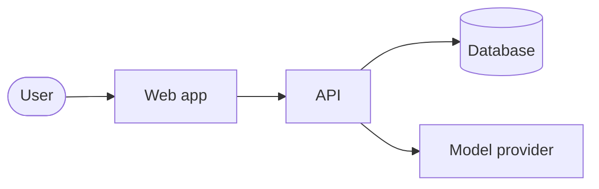

# Architecture

<!-- Kept current by docs-keeper. A judge should understand the system in two minutes. -->

## Overview

<!-- Two or three sentences: what the system does and its main parts. -->

## Components

| Component | Responsibility | Tech | Code |
| --- | --- | --- | --- |
| Web app | | | |
| API | | | |

## The demo path, end to end

<!-- For each demo step: what the user does, which component handles it, which external call happens, typical latency. -->

1.

## AI pipeline

<!-- Models and why each, prompts (paths and versions), structured outputs and validation, streaming, fallbacks, latency budgets, eval set and current score. -->

## Data

<!-- Main entities, where they come from (partner data, seed), what is stored, what is never stored. -->

## Deployment

<!-- Host, environments (preview per PR, production), env vars by name, how a merge reaches production. -->
