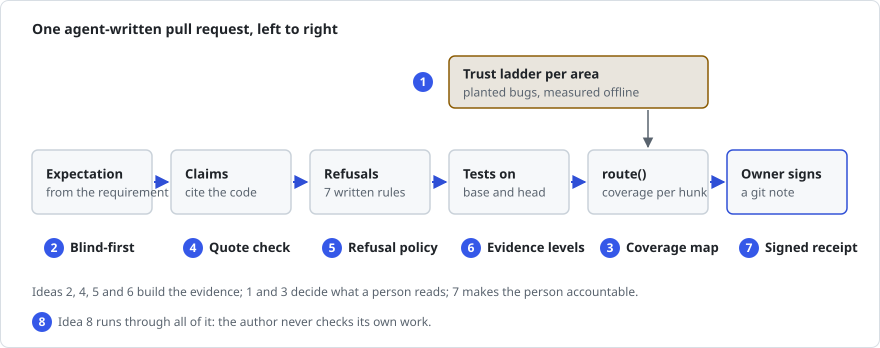

# The nine ideas

Nine ideas for reviewing agent-written code so that a named person can accept a change without reading all of it. Each one stands on its own: a product team can adopt one without the others. Countersign, the app in this repository, shows them working on Tieto's sample repository.

The table is ordered by what makes a change safe to trust, first: nothing breaks old code. The numbers stay as they were; idea 9 was added last.

<picture>
  <source media="(prefers-color-scheme: dark)" srcset="img/ideas-overview-dark.svg">
  
</picture>

The diagram predates idea 9 and doesn't show it yet.

| #   | Idea                                                            | In one sentence                                                                                                                 |
| --- | --------------------------------------------------------------- | ------------------------------------------------------------------------------------------------------------------------------- |
| 9   | [The legacy guard](legacy-guard.md)                             | Every touch on what old systems rely on goes to its named owner with the evidence that covers it, and an unguarded touch raises the tier. |
| 6   | [Evidence levels instead of confidence](evidence-levels.md)     | A claim is labelled by what backs it, never by how sure the model felt.                                                         |
| 8   | [The author never checks its own work](separation-of-duties.md) | An agent's own test is Supported at most, the AI drafts the receipt but a person signs, and the planter never sees the prompts. |
| 1   | [Planted-bug calibration and a trust ladder](trust-ladder.md)   | The reviewer's measured catch rate per area decides how much a person reads there.                                              |
| 3   | [The hunk coverage map](coverage-map.md)                        | Every hunk is Verified, Supported, Read this or Generated, from rules a person can read.                                        |
| 5   | [A written refusal policy](refusal-policy.md)                   | Eight things the AI never decides (R8, legacy contracts, is decided by rule), each with the role that does.                     |
| 4   | [A mechanical quote check](quote-check.md)                      | Code checks that every quoted citation is really in the cited lines.                                                            |
| 2   | [Blind-first review](blind-first.md)                            | The reviewer writes what the requirement should produce before it reads the code or the author's story.                         |
| 7   | [The signed receipt in git](signed-receipt.md)                  | The owner signs what was checked and what wasn't, bound to the exact diff.                                                      |

[Why these ideas](why-these-ideas.md) sets out what each one is, what it adds over a typical AI reviewer and what the recorded results show (it covers the first eight; idea 9 has its own page). [From the challenge to the product](from-challenge-to-product.md) traces where the ideas came from, where each one appears in the app and how they feed each other.

## Next ideas (not built)

No screen shows these; they are recommendations in the concept card.

- **Registered pull requests:** the owner signs the tests before the agent writes any code.
- **Audit sampling for very large PRs:** read a statistically chosen share of hunks instead of all of them.
- **Round-trip property tests for serializers:** for a serializer, test that deserialising what was serialised gives the original.
- **Post-merge reverts as the live source of escapes:** a revert of a merged change feeds the trust ladder as an escape.
- **Guard tests on base and head:** run the tests that guard a touch point on the base and on the change, so a guard means "still passes", not "mentions the code".
- **Optional signing:** the receipt's value is a named owner accepting a record tied to the diff, not the SSH key; a team without keys can keep the record and the owner's name.

Numbers come from the report card (`data/eval/report-card.json`) and the recorded runs in `data/runs/`, each with its sample size. What isn't measured says "not measured yet" and why.

The diagrams in `img/` come in a light and a dark version, and each page shows the one that matches the reader's theme. They are drawn by `pnpm tsx scripts/idea-diagrams/draw.ts`: change the diagram's file there and re-run it, never edit the SVGs by hand.
