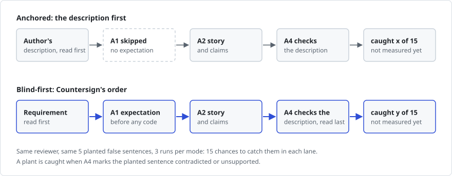

# Idea 2 · Blind-first review, with the anchoring effect measured

The reviewer writes down what the requirement should produce before it reads the code or the author's description, and we count how much reading the description first costs.

> Draft. The anchored-versus-blind count comes from T16 and is "not measured yet" until it runs.

## The problem

An agent-written pull request arrives with the agent's own story. A reviewer who reads it first, human or AI, checks the code against the story instead of the requirement. If the story says "adds a null check" and the code adds one, the review passes, even when the requirement asked for something else.

## How it works

<picture>
  <source media="(prefers-color-scheme: dark)" srcset="img/blind-first-dark.svg">
  
</picture>

1. **Expectation first (A1).** It gets the requirement and one fixed paragraph about the repository. No diff, no description. Per requirement item it writes 1 to 5 expected behaviours, the areas likely touched and the tests it would expect.
2. **Then the code (A2).** It reads the hunks with A1's expectation beside them and writes the story and claims, each citing code.
3. **The description last (A4).** It checks each sentence against the claims: `supported`, `contradicted` or `unsupported`. The last two become findings.
4. **Tests are blind-first too (A5).** One test per functional item, written from the requirement, never from the diff ([Idea 6](evidence-levels.md)).
5. **We measure the effect.** The evidence lane plants false sentences in 5 PR descriptions. The reviewer runs 3 times per mode on each:
   - **Anchored:** A2 reads the description first; A1 is skipped.
   - **Blind-first:** A1, A2, A4 in order (A3 and A5 skipped).

   A plant is caught when A4 marks it `contradicted` or `unsupported`. The result is "anchored caught x of 15, blind-first caught y of 15", with the spread across the 3 runs so a lucky run shows.

## What we measured

Not measured yet. The report card will show both counts with n, the spread and the per-plant breakdown. If blind-first doesn't catch more, it says so. These are our own recorded runs, not a preregistered study.

## How to adopt it

- **You need:** requirements your reviewer can read (a ticket is enough) and the discipline to keep the description out of the first prompt.
- **It costs:** one extra model call per review, small because it reads only the requirement.
- **First step:** put the requirement first in your prompt, ask for expected behaviours, then append the diff. Check the description separately.

## Limits and failure modes

- **No requirement, no blind-first.** Untraceable changes go to a human (`R6`, [Idea 5](refusal-policy.md)).
- **The expectation can be wrong.** A1 informs the review and never overrides what the code and tests show.
- **Five plants is a small sample.** The count shows a direction, not a law; every run is recorded so anyone can recount.

Failure modes we saw go in `docs/lessons.md`.

## Where it comes from

Studies of code review with AI hints find reviewers' attention pulled to what the AI flagged (not yet checked in [`docs/research.md`](../research.md), so no figure here). Preregistration in science (Registered Reports, Chambers 2013) writes expectations down before seeing results.

## In the code

- `src/prompts/a1.ts`: the expectation; never receives the diff or description (T12)
- `src/prompts/a4.ts`: the description check, run last (T13)
- Step order and the `--anchored` flag in `src/pipeline/` (T12–T13)
- Shown on S2, the Blind check tab
