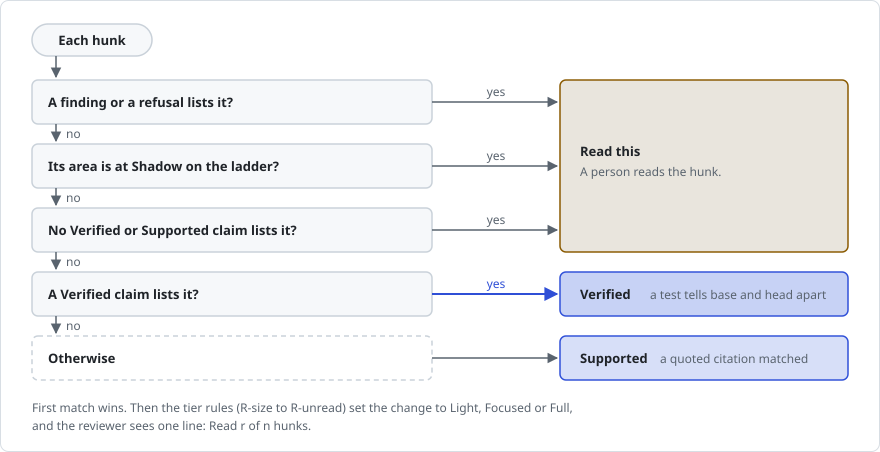

# Idea 3 · The hunk coverage map

Every hunk of a change gets exactly one state, Verified, Supported, Read this or Generated, from rules a person can read, so the human reads only what no checked evidence covers.

## The problem

"The AI reviewed it" doesn't say what a person still has to read, so they read everything or skim and approve. They need a reading list: these hunks, and here is what covers the rest. If a model builds that list, nobody can explain why a hunk was skipped.

## How it works

<picture>
  <source media="(prefers-color-scheme: dark)" srcset="img/coverage-map-dark.svg">
  
</picture>

1. **Coverage per hunk, first match wins:**
   - **Read this:** a finding or refusal lists the hunk, its area is at Shadow ([Idea 1](trust-ladder.md)), or no Verified or Supported claim lists it.
   - **Generated:** the hunk is in a generated file (a snapshot) and no finding or refusal lists it. It stays visible but leaves the reading count, so a change of 400 snapshots doesn't hide its 12 real hunks. The change says so in one line: "411 are generated snapshots: read the template that produces them" (`R-generated`).
   - **Verified:** a Verified claim lists it: a test that fails before and passes after, which the authoring agent didn't write ([Idea 8](separation-of-duties.md)).
   - **Supported:** otherwise; a quote matched the code ([Idea 4](quote-check.md)).
2. **A tier for the change.** Each rule that fires adds one reason with its id; the tier is the highest asked for, and none means Light.
   - **Full:** `R-size` (over 400 changed lines outside generated files), `R-read-share` (75% or more of the non-generated hunks Read this), `R-escape` (a bug escaped in a touched area, so that area's next changes go to Full).
   - **Focused:** `R-refusal` (the AI refused something), `R-contradiction` (description contradicts code), `R-defect`, `R-sensitive-path` (public attributes, diagnostic IDs, the runtime serializer), `R-area-level` (a touched area isn't Trusted), `R-unread` (some hunks Read this and nothing else fired).
3. **One honest line on top:** "Full · Read 7 of 8 hunks · ~10 min (full read ~10 min)" (the recorded MP-2283 review), then one line per reason with its id. Reading time assumes 25 changed lines a minute, and the page says so.
4. **No model in the routing.** `route()` is pure: the same review and ladder levels give the same tier. It runs in the pipeline and in the browser, so a simulated escape re-routes the page live.

## What we measured

Tieto's 4 changes: **0 Light · 0 Focused · 4 Full; read 55 of 473 hunks, ~51 of 119 min**. Per change: MP-2283 read 7 of 8, MP-2129 20 of 33, MP-2234 7 of 9, MP-2297 21 of 423 (402 generated snapshot hunks). All 10 planted-bug runs also went Full. Three changes went Full by `R-read-share` (findings or missing evidence on most hunks), MP-2129 by `R-size` (1043 changed lines). So the tier saves nothing yet; the reading list does, mostly by leaving MP-2297's generated snapshots out.

## How to adopt it

- **You need:** hunks with stable ids, claims that list their hunks, and a ladder level per area (start at Shadow).
- **It costs:** no model calls. Our `route()` is 172 lines with 263 lines of tests.
- **First step:** show the four states in your diff view and the "Read r of n hunks" line; keep your approval flow.

## Limits and failure modes

- **Supported isn't proven.** A quote match shows the claim points at real code, not that it is right.
- **25 lines a minute is an assumption,** not a measured reading speed.
- **Rules can be gamed.** An agent could split changes under 400 lines; the ladder and refusals still apply per hunk.

Wrong tier calls we saw go in `docs/lessons.md`.

## In the code

- [`src/rules/route.ts`](../../src/rules/route.ts): `route()`
- [`src/policy/routing.ts`](../../src/policy/routing.ts): `sizeLimit: 400`, `readShareFull: 0.75`, `linesPerMinute: 25`, the sensitive paths
- Shown on S2: the tier banner and hunk navigator
