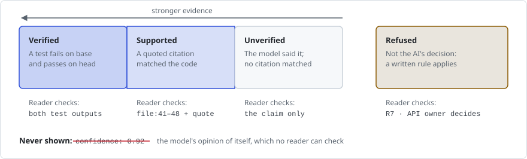

# Idea 6 · Evidence levels instead of confidence scores

Each claim the AI makes is labelled by what backs it, Verified, Supported, Unverified or Refused, and the model's own confidence is never shown.

## The problem

"Confidence: 92%" looks precise and means little. It's the model's opinion of itself, uncalibrated against anything a reader can check, and it invites trust in the number instead of the code. A person deciding whether to sign needs to know what kind of proof stands behind a claim.

## How it works

<picture>
  <source media="(prefers-color-scheme: dark)" srcset="img/evidence-levels-dark.svg">
  
</picture>

Three levels, strongest first, each earned by something a person can check, plus Refused:

- **Verified:** a test that fails before the change and passes after it, not written by the authoring agent. The reader sees both outputs.
- **Supported:** a citation whose quote matched ([Idea 4](quote-check.md)), or the PR's own test. The reader sees the quoted lines or "the PR's own test".
- **Unverified:** the model said it, no citation matched. Shown as unchecked.
- **Refused:** a refusal rule applies ([Idea 5](refusal-policy.md)). Not a level of evidence; the reader sees the rule and who decides.

**Checks set the level, never the model.** The pipeline assigns it from what ran and matched; nothing the model writes can raise it.

How a claim becomes Verified (step A5):

1. **Two sources of tests:** the PR's own added or changed tests, and one test per functional item written by A5 **from the requirement, not the diff** ([Idea 2](blind-first.md)).
2. **Run on both versions** in two git worktrees, base and head, with `dotnet test` (15 minutes per side at most).
3. **Read the difference:**
   - Fails on base, passes on head: **Verified** if A5 wrote the test. The PR's own test gives **Supported** at most, since an agent that writes code and test can put the same mistake in both ([Idea 8](separation-of-duties.md)).
   - Passes on both: stays Supported, noted "the test doesn't tell the versions apart".
   - Fails on head: the claim is retracted and logged.
   - Build error: logged and counted; the claim stays as it was.

The levels feed the coverage map: a Verified claim makes its hunk Verified, a Supported one Supported, unless a finding, refusal or Shadow area marks it Read this ([Idea 3](coverage-map.md)).

## What we measured

Tieto's 4 changes: **9 Verified, 39 Supported, 0 Unverified** of 48 claims. MP-2283 2 of 8 Verified, MP-2297 7 of 13; every Verified claim rests on an A5 test failing on base and passing on head. MP-2129 (0 of 17) and MP-2234 (0 of 10) add API that doesn't compile on the base, so no differential test can run there and no claim is Verified ([lessons](../lessons.md)). All 96 claims in the 10 planted-bug runs are Supported.

## How to adopt it

- **You need:** a citation check for Supported; for Verified, a way to build and test both versions in isolation (git worktrees are enough).
- **It costs:** Supported is free once you have the quote check. Verified costs build and test time per change, minutes for .NET.
- **First step:** stop showing the model's confidence. Show Supported and Unverified from your citations; add Verified where a test can tell the versions apart.

## Limits and failure modes

- **Verified means "a test shows a difference", not "correct".** Writing it from the requirement makes a wrong test less likely, not impossible.
- **Some changes can't be tested this way:** docs, generated snapshots, build configuration. They top out at Supported.
- **The .NET run is our riskiest part.** If it can't run reliably, A5 is cut and Supported is the top level.

Retractions and build errors we saw go in `docs/lessons.md`.

## In the code

- [`src/contracts/common.ts`](../../src/contracts/common.ts): `EvidenceLevel`
- [`src/prompts/a5.ts`](../../src/prompts/a5.ts) and the .NET differential test runner, [`src/pipeline/differential/runDifferentialTests.ts`](../../src/pipeline/differential/runDifferentialTests.ts): run the change's tests in a git worktree and set the level
- Shown on S2, the Story tab: level badge and evidence per claim
