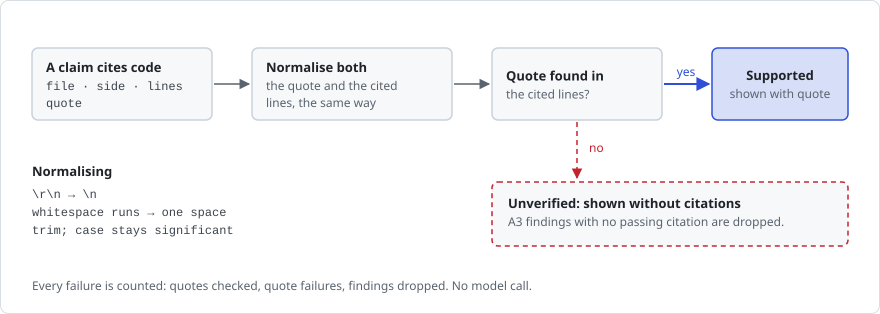

# Idea 4 · A mechanical quote check

Every claim the AI makes cites the code with a file, a line range and a quote, and plain code checks that the quote is really there before anyone sees the claim.

## The problem

A model can describe code that doesn't exist: a call that isn't made, a check that isn't there, a line from another version. In a review that reads as confident evidence. Asking the model to be careful doesn't help; checking its citations does, and needs no second model.

## How it works

<picture>
  <source media="(prefers-color-scheme: dark)" srcset="img/quote-check-dark.svg">
  
</picture>

1. **Claims must cite:** `file`, `side` (`new` for head, `old` for base), `startLine`, `endLine`, exact `quote`.
2. **Normalise both sides alike.** `\r\n` becomes `\n`, every whitespace run (newlines too) becomes one space, then trim. The match is case-sensitive. Models often re-indent quotes; an exact match would call that a hallucination.
3. **Substring match** of the quote in lines `startLine`–`endLine` on the cited side. A file missing there fails with "file not present on new" (or "old").
4. **Claims are downgraded, never dropped.** One passing citation: **Supported**, failing citations removed. None: **Unverified**, no citations, still visible.
5. **Findings must pass too.** A finding with no passing citation is dropped. Contradiction findings are kept, minus failing citations.
6. **A refusal must cite a rule that exists.** One naming a rule id not in the policy is struck as "unknown rule id" ([Idea 5](refusal-policy.md)).
7. **Struck items stay visible.** Each failing citation, dropped finding and struck refusal is recorded with its claim's id. S3 totals them over all runs: quotes checked, quote failures, findings dropped, claims retracted by a failing test. That is the reviewer's hallucination rate on its own output.

## What we measured

From the report card, over all recorded runs: **quote failures 0 of 790 quotes checked**, 0 findings dropped, 0 claims retracted by a failing test. A unit test checks that a deliberately wrong quote is caught, so the zero isn't a check that can't fire. It says this model quoted this repository accurately, not that its claims are right (see Limits).

## How to adopt it

- **You need:** structured output with the citation fields, and both versions of each file.
- **It costs:** no model calls; string handling and tests.
- **First step:** add the fields to your output schema and log failures before hiding anything. The count tells you how much of your AI review is invented.

## Limits and failure modes

- **A real quote can support a wrong claim.** The check proves the code exists, not that the model understood it. So a quote earns Supported, and only a test earns Verified ([Idea 6](evidence-levels.md)).
- **Short quotes match too easily.** `return;` passes almost anywhere. A minimum length is a sensible next rule; we haven't added it.
- **Normalisation can join tokens** across line breaks in rare cases. Fine for code, not for prose.

Failure modes we saw go in `docs/lessons.md`.

## Where it comes from

The admissibility of expert evidence (Daubert v. Merrell Dow, 1993; Federal Rule of Evidence 702): a claim reaches the reader only if it fits the record, and struck claims stay in the log. See [`docs/research.md`](../research.md).

## In the code

- The quote check in `src/pipeline/`, between A2 and A3: checks every quoted line against the diff
- [`src/contracts/common.ts`](../../src/contracts/common.ts): citation and evidence-level types
- Shown on S2, the Story tab, and on S3 under hallucinations
