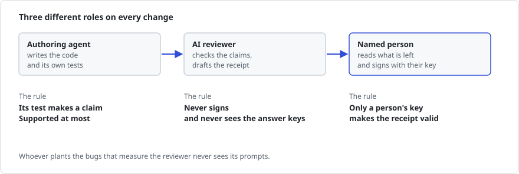

# Idea 8 · The author never checks its own work

Whoever writes the code, the test, the receipt or the planted bugs never also judges them: an agent's own test makes a claim Supported at most, the AI drafts the receipt but only a named person signs it, and whoever plants the bugs never sees the prompts.

> Draft. Rates come from the planted-bug eval and are "not measured yet".

## The problem

An agent that writes both the code and its test can encode one mistake in both. The test passes, and a reviewer who counts it as proof has been told the same thing twice; the failure-mode research calls it "double confirmation". The same trap appears elsewhere: an AI that drafts and signs its own receipt leaves no one accountable, and a planter who reads the reviewer's prompts grades their own homework.

## How it works

<picture>
  <source media="(prefers-color-scheme: dark)" srcset="img/separation-of-duties-dark.svg">
  
</picture>

Three roles on every change, never the same one twice:

1. **The authoring agent's test is Supported at most.** A test the PR adds shows the change behaves as the author meant, not as the requirement says. When it fails on base and passes on head the claim is Supported, labelled "the PR's own test". Verified needs a test written from the requirement without seeing the diff (A5, [Idea 6](evidence-levels.md)).
2. **The AI drafts, a person signs.** `pnpm countersign draft` writes the receipt; only `pnpm countersign sign`, with the owner's SSH key, makes it valid ([Idea 7](signed-receipt.md)).
3. **The planter never sees the prompts.** The evidence lane writes planted bugs and contradiction plants blind: it doesn't open the prompts, pipeline or recorded output until the plants are merged ([Idea 1](trust-ladder.md)).
4. **The roles are shown.** S2 and S4 carry "Written by <agent> · Reviewed by rv1 · Signed by <owner>", and claims backed only by the PR's own test say so.

## What we measured

Not measured yet. Two numbers will show it: how many claims the PR's own tests would have raised from Supported to Verified, and the planted-bug catch rate with blind plants, with its sample size. We claim no effect size.

## How to adopt it

- **You need:** a way to tell which tests the authoring agent wrote (the PR's changed test files are enough) and a signing step only a person can complete.
- **It costs:** no model calls; test provenance is a check on file paths.
- **First step:** label evidence "the PR's own test" and cap it one level below independent tests. Then require a human key on the approval record.

## Limits and failure modes

- **Two agents aren't two people.** A5 and the authoring agent may share a model family and blind spots. We separate the inputs (A5 never sees the diff), not the weights.
- **A team of one** still signs as the owner, but nobody else checks the author's work; the receipt says what the owner read.
- **Blind planting is enforced by lane, not by code.**

Failure modes we saw go in `docs/lessons.md`.

## Where it comes from

Separation of duties: the person who makes a change isn't the one who approves it. PCI DSS v4.0.1 requirement 6.2.3.1 asks for code review by someone other than the author. See [`docs/research.md`](../research.md).

## In the code

- The A5 test runner in `src/pipeline/`: tests the PR added give Supported at most (T14)
- `src/receipt/`: only `sign` writes the signed note (T20)
- Shown on S2 (roles line, "the PR's own test" lines) and S4 (roles line)
