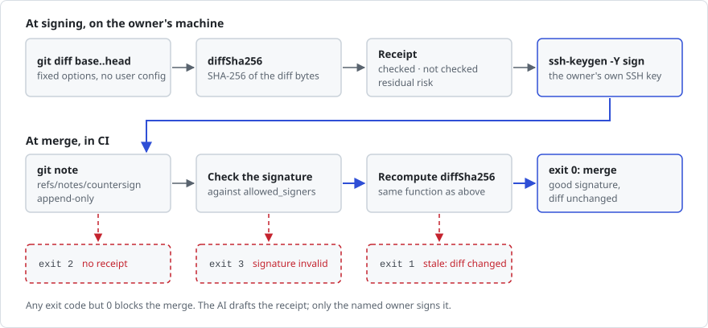

# Idea 7 · The signed receipt in git, tied to the exact diff

The named owner signs a receipt of what was checked, what wasn't and what risk they accept, stored in git next to the commit and bound to a hash of the exact diff.

## The problem

"Approved by" on a pull request says almost nothing: on what evidence, with which parts unread, accepting which risks? It lives in the hosting platform, not with the code, and stays green when the diff changes after approval. Accountability needs a record of what the person took responsibility for, signed so they can't deny it, that goes stale once the code moves.

## How it works

<picture>
  <source media="(prefers-color-scheme: dark)" srcset="img/signed-receipt-dark.svg">
  
</picture>

1. **The review drafts the receipt** (`pnpm countersign draft <changeId>`): what was **checked** and by whom (`tool`, `ai-supported` or `human`), what was **not checked** (Read this hunks, Unverified claims) and the **residual risk**, including refusals ([Idea 5](refusal-policy.md)). The owner edits it. The AI never signs ([Idea 8](separation-of-duties.md)).
2. **A per-hunk ledger of who read what:** `hunks: { hunkId, file, coverage, readBy }` ([Idea 3](coverage-map.md)).
3. **Bound to the exact diff.** The receipt carries base and head commits, tree hashes and `diffSha256`, a SHA-256 of a `git diff` with fixed options and no user config, so every machine gets the same hash.
4. **Signed with the owner's own SSH key.** `pnpm countersign sign` signs canonical JSON (sorted keys) with `ssh-keygen -Y sign -n countersign-receipt`.
5. **Stored in git, append-only:** a note on the head commit under `refs/notes/countersign`. A second signature on the same commit is refused.
6. **`pnpm countersign verify` is the merge gate.** It checks the signature against `allowed_signers`, then recomputes the diff hash. Exit 0: good signature, diff unchanged. 1: "Stale: the diff changed since signing". 2: "No receipt for <changeId>". 3: "Signature invalid".

## What we measured

No rates to measure. The MP-2283 receipt lists 8 checked items (2 by `tool`, 6 `ai-supported`) and 7 not checked. It is signed with a real ED25519 key and committed with its verify output to [`data/receipts/mp-2283.json`](../../data/receipts/mp-2283.json): "Good "countersign-receipt" signature for miska-voutilainen", "diff unchanged".

## How to adopt it

- **You need:** git, `ssh-keygen` (OpenSSH 8.2 or newer) and an `allowed_signers` file.
- **It costs:** no service, no model calls; a small CLI around `git notes` and `ssh-keygen`.
- **First step:** a CI step that fails when the head commit has no valid note under `refs/notes/countersign`. Start with a receipt naming only the owner and diff hash.

## Limits and failure modes

- **A signature proves who signed, not that they read.** The receipt makes the unread part explicit, so signing is deliberate.
- **Notes are easy to forget to push** (`git push origin refs/notes/countersign`). Verify fails closed (exit 2).
- **A rebase or a new commit makes the receipt stale:** it binds the head commit, the base and head trees and the diff hash. A rebase onto a changed base can change what the same diff does, so the change is reviewed and signed again.
- **Personal SSH keys are a reference choice;** an organisation would use Sigstore or similar.

## Where it fits in regulated delivery

Auditors already ask who approved a change, what was checked and what risk was accepted, with the approver separate from the implementer. PCI DSS 6.2.3.1 asks for review by someone other than the author, approved before release, and DORA's rules on ICT change management ask for approval separate from implementation. The receipt is that approval record, not a compliance claim; see [`docs/research.md`](../research.md).

## In the code

- `src/receipt/`: the countersign CLI: draft, sign, verify and export a receipt
- `src/lib/git/diffIdentity.ts`: `computeDiffIdentity()`, which feeds both review and receipt
- Shown on S2, the Receipt tab (signed, unsigned or stale), and S4, the full receipt
