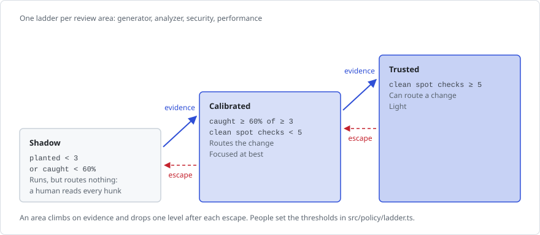

# Idea 1 · Planted-bug calibration and a trust ladder per area

Test the AI reviewer on bugs planted by someone who never sees its prompts, and let its measured catch rate in each area decide how much a human reads there.

> Draft. Numbers come from the planted-bug eval (T16) and are "not measured yet" until it runs.

## The problem

Teams trust an AI reviewer everywhere or nowhere, and both are guesses. A reviewer can be sharp on generator code and blind to security bugs in the same repository, and nobody knows until a bug escapes. Trust should be earned per area, from evidence, and lost the same way.

## How it works

<picture>
  <source media="(prefers-color-scheme: dark)" srcset="img/trust-ladder-dark.svg">
  
</picture>

1. **Areas come from paths.** For Tieto's MessagePack-CSharp: `generator`, `analyzer`, `security`, `performance`. The first matching path rule wins (`src/MessagePack.SourceGenerator/Analyzers/**` → `analyzer`).
2. **Someone else plants the bugs.** A teammate who never opens the prompts writes small, realistic bugs into the real code, each with an answer key (file, line range, area). The reviewer runs on each blind.
3. **A catch is scored mechanically:** a `defect` or `missing` finding cites the key's file on the head side, within ±3 lines of the planted range, in the same area.
4. **The catch rate sets a level:**
   - **Shadow:** fewer than 3 planted bugs, or catch rate below 60%. The reviewer runs but routes nothing; a human reads every hunk in the area.
   - **Calibrated:** not Shadow, fewer than 5 clean spot checks. Routes Focused review at best.
   - **Trusted:** not Shadow, 5 or more clean spot checks. Can route Light.
5. **An escape drops a level.** A bug that reaches a human anyway moves the area down one step, and rule `R-escape` sends that area's next changes to Full review ([Idea 3](coverage-map.md)).

The numbers 3, 60% and 5 live in one policy file, so a team can argue about them in a pull request.

## What we measured

Not measured yet. The eval runs the reviewer on 10 planted bugs across four areas; the report card shows "<caught> of <planted> caught" per area, never a bare percentage. We have no spot-check workflow, so `spotChecksClean` is 0 and no area reaches Trusted. The report card says so.

## How to adopt it

- **You need:** areas with path rules, a planter who never sees the prompts, an answer key per bug.
- **It costs:** one reviewer run per plant, plus writing the plants. Cost per run: not measured yet.
- **First step:** start every area in Shadow, plant three bugs in the area you care about most, and publish the catch rate with its sample size.

## Limits and failure modes

- **Small samples.** Three bugs is a floor; 2 of 3 can be luck, so the sample size sits next to the rate.
- **Planted bugs aren't real bugs.** Planters write the kind they can think of; real escapes correct that.
- **Blindness is enforced by process.** Planting happens in a separate lane, merged before anyone sees review output.

Failure modes from our runs go in `docs/lessons.md`.

## Where it comes from

Continuous sampling plans in manufacturing inspection (Dodge, 1943; Dodge and Torrey, 1951): sample after enough clean results, and after a defect gets through return to full inspection ("cluster arrest", our `R-escape`). See [`docs/research.md`](../research.md).

## In the code

- [`src/rules/ladder.ts`](../../src/rules/ladder.ts): `ladderLevel()` and `applyEscapes()`
- [`src/policy/ladder.ts`](../../src/policy/ladder.ts): `minPlanted: 3`, `minCatchRate: 0.6`, `spotChecksForTrusted: 5`
- Eval scoring in `src/pipeline/eval/`: `pnpm evals` scores the planted-bug runs and writes `data/eval/report-card.json`
- Shown on S3, "Can the reviewer be trusted?"
